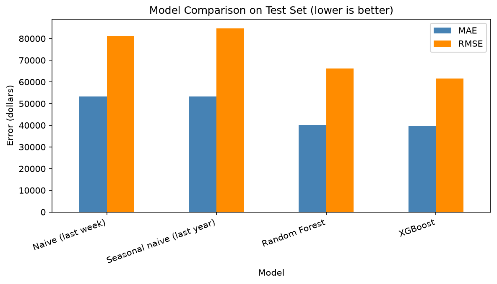
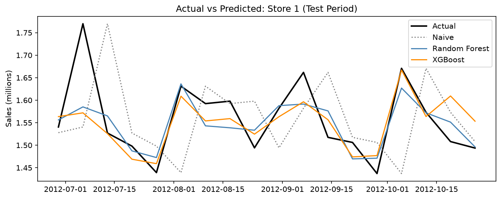
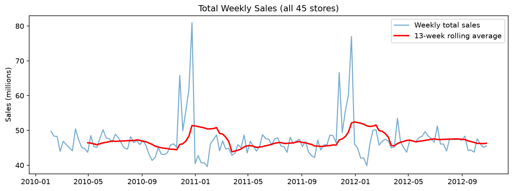
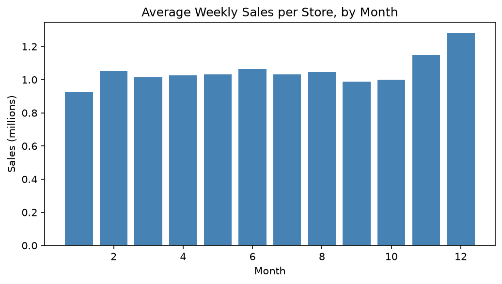
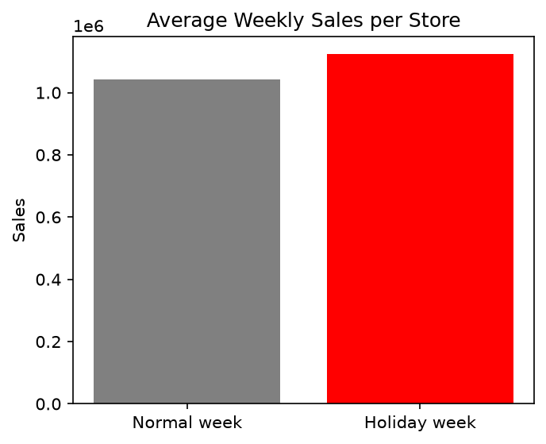
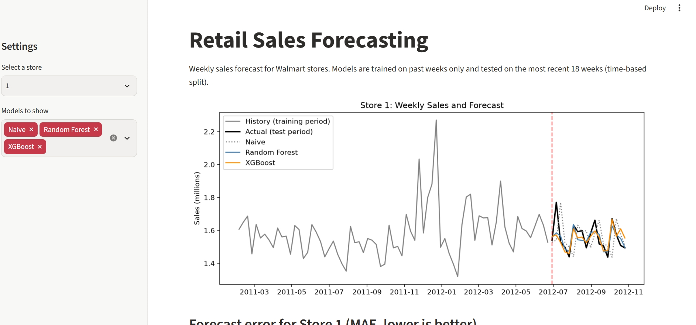
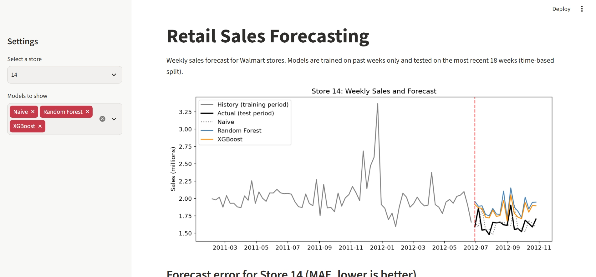

# Retail Sales Forecasting

Weekly sales forecasting for Walmart stores using SQL (SQLite), Random Forest and XGBoost, with an interactive Streamlit app.

## Problem
A store manager needs to know how much will sell next week so that stock can be planned. Too little stock means lost sales, too much means waste. This project forecasts weekly sales for each store.

## Dataset
Walmart Store Sales data from Kaggle (weekly sales per store, holiday flag, store type and size).
The raw files are not uploaded to this repo because of size. Download them from Kaggle and place them in `data/raw/`.

## Approach
1. **SQL:** loaded the data into SQLite and used `JOIN` and `GROUP BY` to build weekly sales per store.
2. **EDA:** analysed trend, yearly seasonality and the holiday effect (charts in `images/`).
3. **Features:** lag features (`lag_1`, `lag_2`, `lag_4`, `lag_52`), rolling means (4 and 12 weeks), month, week of year, holiday flag, store size and type.
4. **Time-based split:** the last 18 weeks (from 2012-06-29) are the test set, everything before is train. A random split would let the model see the future, which is data leakage, so it was not used. The code checks that all train dates are earlier than test dates.
5. **Models:** two naive baselines, then Random Forest and XGBoost.
6. **Evaluation:** MAE and RMSE on the test set.

## Results

| Model | MAE | RMSE | MAE improvement vs naive | RMSE improvement vs naive |
|---|---|---|---|---|
| Naive (last week) | 53,352 | 81,172 | 0.0% | 0.0% |
| Seasonal naive (last year) | 53,259 | 84,760 | 0.2% | -4.4% |
| Random Forest | 40,137 | 66,127 | 24.8% | 18.5% |
| XGBoost | 39,720 | 61,661 | 25.6% | 24.0% |

XGBoost is the best model: its MAE is 25.6% lower than the naive baseline. Seasonal naive has a worse RMSE than naive, so simply copying last year's value is not enough.




## EDA




## Streamlit app
Pick a store in the sidebar and see the actual vs forecast chart with MAE for each model.




## How to run
```powershell
git clone https://github.com/Muskanprajapati12/retail-sales-forecasting.git
cd retail-sales-forecasting
python -m venv .venv
.venv\Scripts\Activate.ps1
pip install -r requirements.txt
```
Put the Kaggle CSV files in `data/raw/`, then run the scripts in `src/` in this order:
`load_to_sqlite.py`, `weekly_sales_sql.py`, `build_features.py`, `split_data.py`, `baseline.py`, `train_random_forest.py`, `train_xgboost.py`, `compare_models.py`.
Finally:
```powershell
streamlit run app/app.py
```

## Limitations
- The test period is only 18 weeks (mid-2012 to autumn) and does not include Thanksgiving or Christmas, so the holiday peak is not fully tested.
- Lag features use actual past sales, so this is a one-week-ahead forecast. Forecasting many weeks ahead needs a different setup.
- Only 11 features are used; external data like temperature, fuel price or CPI was not added.
- No hyperparameter tuning was done; models use mostly default settings.

## Tech stack
Python, Pandas, NumPy, SQLite, Scikit-learn, XGBoost, Matplotlib, Seaborn, Streamlit
